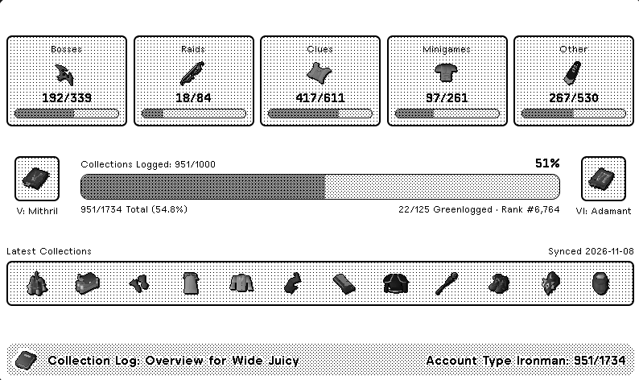
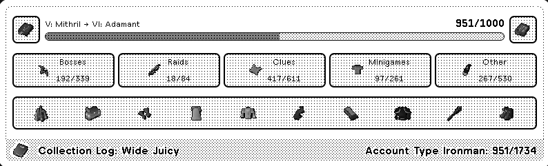
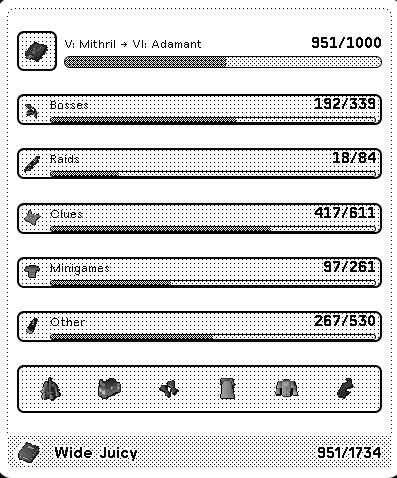
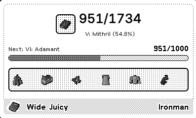

# OSRS Collection Log for TRMNL

A [TRMNL](https://trmnl.com) plugin that shows your Old School RuneScape **Collection Log** on your e-ink display, styled after the in-game Collection Log Overview:



- **Bosses, Raids, Clues, Minigames and Other**: obtained / total slots for each, with progress bars
- **Collection Log rank**: your current rank book (Bronze → Gilded), the next rank, and progress toward it
- **Totals**: slots logged, categories completed ("greenlogged") and your hiscores rank
- **Latest Collections**: icons of your most recent collection log drops

Data comes from [TempleOSRS](https://templeosrs.com/collection-log/). Item icons come from RuneLite's static item icon CDN.

## Requirements for players

Your collection log has to be synced to TempleOSRS:

1. In RuneLite, install the **TempleOSRS** plugin from the Plugin Hub.
2. Open your Collection Log in game and press the TempleOSRS sync button. Turn on auto-sync to keep it up to date.
3. Search your name on [templeosrs.com](https://templeosrs.com) and press **Update** so your profile exists.

TempleOSRS only lists items in **Latest Collections** that were obtained *after* your first sync.

## Settings

| Setting | Description |
| --- | --- |
| **RuneScape Name (RSN)** | Your OSRS name as synced on TempleOSRS |
| **Recent Drops Filter** | `All Drops`, or `Notable Only` pets, rare clue items and other significant drops |

The plugin refreshes every 60 minutes.

## Layouts

| View | Contents |
| --- | --- |
| **Full** | 5 category cards, rank bar with current/next rank books, totals, 12 latest drops |
| **Half Horizontal** | Rank bar, 5 compact category cards, 10 latest drops |
| **Half Vertical** | Rank bar, 5 category rows with progress bars, 6 latest drops |
| **Quadrant** | Total slots, current rank, progress to next rank, 6 latest drops |

All views support TRMNL OG and TRMNL X, landscape and portrait, 1-bit / 2-bit / 4-bit, and dark mode.

### Half Horizontal



### Half Vertical and Quadrant

| Half Vertical | Quadrant |
| --- | --- |
|  |  |

## Development

Requires [Docker](https://docs.docker.com/get-docker/) with Buildx. Everything runs in the official [trmnlp](https://github.com/usetrmnl/trmnlp) image; the version is set by the `FROM` line in `Dockerfile`. Run `make help` to list every target.

```bash
make build-dev    # build the development image (…:local-dev)
make start        # restart the dev server with live reload at http://localhost:4567
make stop         # stop the dev server
make logs         # follow server output
make lint         # trmnlp lint
make plugin-test  # trmnlp test --report report
make inline-icons # re-download static icons into assets/icons/ and inline them into src/shared.liquid
make update-categories # re-bake TempleOSRS's category map into src/transform.py

make build        # build the production image (…:local), plugin baked in
make run          # serve the production image at http://localhost:4567
make test         # container-structure-test against the production image (tests.yaml)
make shell        # bash inside the production image
make which-image  # print the image name
```

Use a different port with `make start PORT=4568`. Images are named `ghcr.io/nickspaghetti/trmnl-osrs-clog/trmnl-osrs-clog:<version>`.

`make test` needs [container-structure-test](https://github.com/GoogleContainerTools/container-structure-test) (`brew install container-structure-test`).

The dev container mounts the project folder, so edits under `src/` reload the preview automatically.

### Previewing another player

Change `rsn` in `.trmnlp.yml`:

```yaml
custom_fields:
  rsn: Mikael        # try: coxie, jabbau, Norti, iron 3 hit, berserker, Hard Twiddle
  only_notable: '0'  # '1' for notable drops only
```

### Testing

`make plugin-test` runs `tests/plugin_spec.rb`, which uses canned TempleOSRS responses and checks:

- every view on TRMNL OG and X, landscape and portrait, light and dark mode
- overlapping text, leftover placeholder values and script errors
- rank and category math (including an Ironman with a spaced RSN)
- the error screen for a player with no synced log

Open `report/index.html` afterwards to see every rendered screen.

To render PNGs from live data:

```bash
docker run --rm -v "$(pwd):/plugin" $(make -s which-image)-dev build --png   # writes _build/*.png
```

### Project structure

```
.
├── .github/
│   ├── CODEOWNERS
│   └── workflows/
│       ├── ci.yml           # lint + test on pull requests and main
│       ├── release.yml      # manual release
│       └── update-categories.yml  # weekly category map refresh (opens a PR)
├── Dockerfile               # development + production targets, based on trmnl/trmnlp
├── Makefile                 # image build, dev server, lint, tests
├── tests.yaml               # container-structure-test spec
├── .trmnlp.yml              # local dev config (not uploaded)
├── src/
│   ├── settings.yml         # plugin config: polling URLs, form fields
│   ├── transform.py         # turns the 2 API responses into display data
│   ├── shared.liquid        # styles and reusable templates
│   ├── full.liquid
│   ├── half_horizontal.liquid
│   ├── half_vertical.liquid
│   └── quadrant.liquid
└── tests/
    └── plugin_spec.rb
```

### How the data works

`src/settings.yml` polls two TempleOSRS endpoints on each refresh:

1. `player_collection_log.php`: player totals, hiscores rank, and the IDs of every item obtained
2. `player_recent_items.php`: the 12 most recent drops

Which items belong to each of the 5 top-level tabs comes from TempleOSRS's `categories.php`, but that list only changes when Jagex adds new items, so it is baked into `src/transform.py` instead of fetched every refresh. TempleOSRS asks for at most 5 requests per minute and TRMNL's servers share IP addresses, so fewer requests means fewer `429 Too Many Requests` errors. Run `make update-categories` after a content update that adds collection log slots. The **Update categories** GitHub Action does this every Thursday and opens a pull request when the list changes.

`src/transform.py` (a TRMNL serverless transform) counts obtained items per tab, works out the rank (Bronze 100 → Dragon 1,200 → Gilded at 90% of slots, rounded down to the nearest 25), and builds the icon URLs.

## Credits

- Collection log data: [TempleOSRS](https://templeosrs.com) ([API docs](https://templeosrs.com/api_doc.php))
- Item icons: [RuneLite](https://runelite.net)
- Rank and collection log reference: [OSRS Wiki](https://oldschool.runescape.wiki/w/Collection_log)
- Built with the [TRMNL Framework](https://trmnl.com/framework) and [trmnlp](https://github.com/usetrmnl/trmnlp)

Old School RuneScape is a trademark of Jagex Ltd. This project is not affiliated with Jagex or TempleOSRS.
